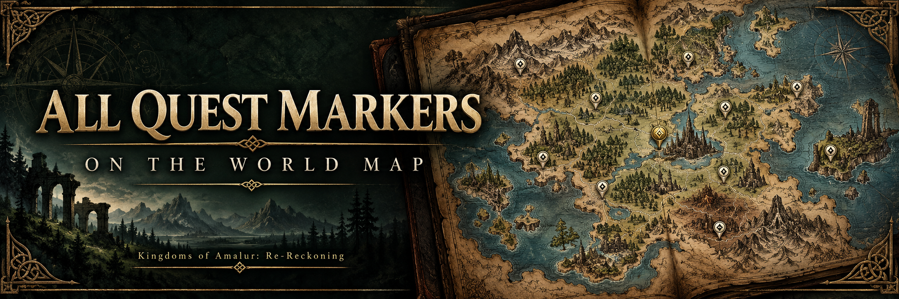
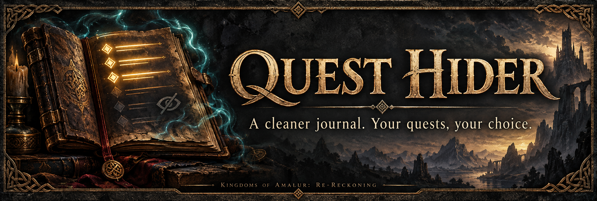

# KOARR Modding

Independent utility mods for **Kingdoms of Amalur: Re-Reckoning**.
Install only the mod ZIPs you want; the repository's source archive is not an installer.

## All Quest Markers on World Map

Show world-map objectives for untracked quests alongside your tracked quest.
**Version 1.0.1 — confirmed working on GOG with Fatesworn and Mod Framework v1.4.**



- [Nexus Mods](https://www.nexusmods.com/kingdomsofamalurrereckoning/mods/97)
- [Download ZIP](all-quest-markers/dist/AllQuestMarkers-1.0.1.zip) · [Checksum](all-quest-markers/dist/AllQuestMarkers-1.0.1.zip.sha256)
- [Installation, screenshot and compatibility](all-quest-markers/README.md)

## Quest Hider

Hide ongoing quests from the journal and filter their objective icons on maps.
Press **F6** to hide/restore a quest and **F7** to switch to the hidden list.
**Version 1.0.0 — journal hiding and restoration confirmed in-game.**



- [Download ZIP](quest-hider/dist/QuestHider-1.0.0.zip) · [Checksum](quest-hider/dist/QuestHider-1.0.0.zip.sha256)
- [Installation, controls and testing limits](quest-hider/README.md)
- [Nexus listing description](quest-hider/docs/quest-hider-nexus-description.txt) · [Metadata](quest-hider/docs/quest-hider-nexus-metadata.json)

## Inventory Plus

Find items by displayed name with **Ctrl+F** and cycle native/name ordering with
**Ctrl+S**. **Version 0.3.2 footer correction** restores native category navigation after
the failed tab preview. Search, name sorting and clearing were confirmed in 0.2.1;
category tabs and damage/stat sorting remain planned.

- [Download ZIP](inventory-plus/dist/InventoryPlus-0.3.2-preview.zip) · [Checksum](inventory-plus/dist/InventoryPlus-0.3.2-preview.zip.sha256)
- [Installation and focused test](inventory-plus/README.md)
- [Specification](inventory-plus/docs/inventory/spec.md) · [Research](inventory-plus/docs/inventory/research.md) · [Development notes](inventory-plus/docs/inventory/spike.md)

## Requirements and installation

The supported setup is Windows, the GOG edition with Fatesworn, and
[Mod Framework v1.4 by DevCortez](https://www.nexusmods.com/kingdomsofamalurrereckoning/mods/9).
Consult each mod's guide for executable restrictions and testing coverage.

Close the game, extract the chosen mod ZIP beside `koa.exe`, merging `mods`,
and restart. The mods install independently; none requires the others.

## Repository layout and development

```text
all-quest-markers/  Mod manifest, guide, docs, tests, packaging tools and ZIPs
quest-hider/        Mod files, native source, docs, tests, tools and ZIPs
inventory-plus/     Mod files, native source, probe, docs, tests, tools and ZIPs
common/            Shared native bridge and development utilities
```

Each mod folder is its own development root. Run its documented commands from
that folder. ZIPs retain their existing game installation paths (`mods/...`);
the repository layout does not add a folder inside the game.

Build native helpers from the repository root:

```sh
python quest-hider/tools/build_quest_hider.py
python inventory-plus/tools/build_inventory_plus.py
```

Run all offline tests (set `QH_LUA` to a Lua 5.1 interpreter):

```sh
python common/tools/test_all.py
```

Package a mod with its `tools/package*.py` script. Published ZIPs and checksums
are retained byte for byte during this reorganization; no release was replaced.
See [shared utilities](common/README.md) for common dependencies.

Original mod code is [MIT licensed](LICENSE). Game files and framework binaries
are not bundled. Mod Framework is by [DevCortez](https://github.com/DevCortez/KoaModFramework).
