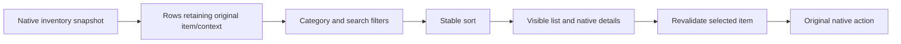

# Inventory Plus — proposed specification

**Status:** source audit complete; first native search-input UI trial implemented.
The [UI trial](ui-trial.md) does not yet change rows, add tabs or apply search.
The complete feature set below remains the target, not a claim of shipped behavior.
Working name: **Inventory Plus**.
Target: GOG Re-Reckoning with Fatesworn and Mod Framework v1.4, in this same
repository with its own files and eventual ZIP.

Read the [research and source audit](research.md) for the evidence, existing mods
and unverified technical assumptions behind these decisions.

## Product goal

Let a PC player find, compare and act on a carried item with less navigation and
scrolling. Keep the game recognizable: Amalur's typography, rarity colors,
original item tooltips, equipment comparison and item actions remain familiar.

The first version focuses on **visible category tabs, item-name search, filters
and sorting**. Large-bag capacity, automated junking and comprehensive effect
comparison already have existing solutions. Compatibility with them is a goal,
not an already-tested claim.

## Proposed screen

This is an original interaction wireframe, not a screenshot or proof that its
widgets can already be instantiated by the framework.

```text
INVENTORY                                                    Bag: 84 / 120
[All] [Weapons] [Armor] [Accessories] [Consumables] [Items] [Junk]

Search items: [ frost                         x ]    [Clear filters]
Type: [All v]    Rarity: [Any v]    [ ] Equippable    Sort: [Name A-Z v]

ITEM                         RARITY    REQ. LVL  BASE VALUE | ITEM DETAILS
[E] Frostblade               Rare          18         430 | Native description
    Greater Frost Potion     Common         —          85 | and equipment
                                                           | comparison
2 results / 84 carried entries                              |

[Equip / Use] [Other native actions]      Ctrl+F: Search   Esc: Clear / Back
```

Names, numbers and item properties above are illustrative. Status labels are not
limited to color. Base value is not advertised as the merchant's sale price.
No weight column: this game uses inventory capacity, not a newly invented
encumbrance system.

Keep all category tabs discoverable. At smaller widths, use two tab rows rather
than hiding categories behind horizontal scrolling. Retain the native detail
pane and use its available width. Extra table columns are subordinate to readable
names and tooltips; no tiny-font mode is required to use the mod.

## Scope and priority

| Priority | Feature | Release condition |
| --- | --- | --- |
| P0 | Preserve item identity and original action behavior | Every displayed row resolves to the exact original item/stack and context |
| P0 | Direct tabs for the six existing categories | Mouse and keyboard navigation, visible active tab, no missing items |
| P0 | Search by displayed item name | Real edit box and focus isolation proven; no console-based search workflow |
| P0 | Explicit name sort and Reset/Clear Filters | Stable ordering, visible sort direction and reversible filtering |
| P1 | All view across non-junk categories | Mixed-category row/action routing proven; otherwise absent from the first preview and explicitly documented |
| P1 | Type/slot, rarity and equippable filters | Each property's meaning and reader verified on the target build |
| P1 | Rarity, required-level and base-value sort | Verified typed properties; unsupported options omitted and documented |
| Later | Favorites tab and persistent item tags | Stable instance identity across save/load, stack split/merge and characters |
| Later | Protection from sale/junk/salvage, bulk marking | Complete action-path audit; a star alone cannot imply protection |
| Later | Stash and vendor browsing | Separate native contexts and transaction rules verified |

P0 is the minimum useful inventory preview. P1 is the intended v1.0 scope. A build
without working search must be called a navigation prototype, not the completed
Inventory Plus release. Any scope reduction should be explicit in its README.

## Browsing rules

### Tabs and scope

Use Weapons, Armor, Accessories, Consumables, Items and Junk as the initial
baseline, verifying the remaster's actual labels and subcategories in the spike.
The new UI exposes them directly rather than inventing a second classification.

All contains carried non-junk entries across the other categories. Equipped items
appear only if they belong to the native inventory dataset, and appear once.
Junk stays a dedicated context; searching All must not silently switch an action
from Use/Equip to Destroy. Quest items remain reachable through Items and All.
Stash, vendor stock and loot containers are outside the carried inventory view.

Search applies to the selected tab. Nonempty search text stays when changing tabs;
counts and the active tab make its scope clear. Each tab shows a result count
when filtering is active. Switching tabs resets incompatible type/slot filters.
A zero-result tab is still selectable.

### Search and filters

- Match substrings of the displayed, localized item name; case-insensitive and
  diacritic-sensitive. Do not search generated tooltip text in v1.
- Trim leading/trailing spaces. Empty text means no name filter. Define and test
  Unicode handling; Lua byte-wise lowercasing alone is insufficient for a claim
  of general localized case-insensitive search.
- Combine search and different filter groups with AND. A single-choice dropdown
  selects one value within its group. There is no ambiguous multi-select logic.
- Type/slot options follow the native category: for example weapon subtype or
  armor slot. Do not infer an item's type from translated name text.
- Rarity uses verified native tiers in their native order, including set items;
  do not copy the terminology in an unrelated mod's config as the canonical enum.
- Equippable means the native equipment action's requirements are satisfied.
  It does not mean "better," "currently equipped" or "usable consumable."
  Hide this filter in categories where it has no meaning.
- Items can offer Quest / Other as a subtype only after quest flags are verified.
  Filtering never clears a quest flag or makes an item removable.
- Clear Filters resets query, rarity, type/slot and equippable filters, retaining
  the chosen tab and sort. Show it prominently whenever a filter is active.
- An empty result says "No matching items" and offers Clear Filters. Show no item
  details or enabled item actions when no row is selected.

### Sorting and selection

Provide a dropdown and, where feasible, clickable column headers. Selecting the
active sort again reverses direction. Default is Name A–Z. Keep the native rarity
ordering in rarity sorts; required level and generated item level are distinct.

Name is the secondary key for non-name sorts. Original snapshot ordinal is the
final stable tie-breaker. Unknown values display an em dash and sort after known
values in both directions; they are not treated as zero. The item's native
handle remains attached to the row independently of its sort position.

Preserve the selected item across a sort/filter change when it remains visible.
Otherwise select the nearest remaining row, or clear selection if none remain.
When the item is consumed, sold elsewhere or moved by another mod, refresh the
snapshot and validate selection before enabling another action. Do not retain a
stale handle across a character load or inventory-window recreation.

## Input and visible feedback

Mouse users can click tabs, search, dropdowns and Clear Filters; the mouse wheel
scrolls the item list under its normal focus rules. Do not require function keys
to discover core features.

Proposed keyboard shortcut: **Ctrl+F** focuses search, subject to the target
build's binding audit. Show the actual configured shortcut beside search and in
the footer. Do not reserve F6/F7 (Quest Hider) or F9 (Spyglass).

While entering text, letters and native action keys must not equip, use, junk or
destroy an item. Suppression must include the game's action-event handling, not
just this mod's key polling. Text focus ends before any item action can run.

Escape follows this order: leave text editing; clear active filters on a further
press; then use the normal game Back/Close behavior. A cleared search returns
focus to the item list. Native Back and destructive-action confirmations remain
available. Tab/focus navigation must not trap the player in the search control.

Preserve baseline controller navigation and native item actions. New tabs,
filters and Clear Filters must be focusable with a controller. Text search may
require keyboard input in the first PC release if a native virtual keyboard is
not available; disclose that limit visibly in the documentation and test that
controller users can exit search focus. Do not claim full controller text entry
until demonstrated.

Remember tab and sort during the running session. Reset query and filters on a
fresh inventory open to avoid hidden items on the next visit. Configurable
startup defaults can live in a Lua config; cross-session UI-state persistence is
optional and must not delay the first version.

## Item actions and boundaries

Reuse the native single-item/stack actions and confirmation dialogs. Sorting a
list must never change which item Equip, Use or Junk operates on. Pass the
original item's handle, stack information and native category/context, not the
visible row index. If that mapping cannot be validated, disable the affected
action in the prototype.

Opening the inventory or changing a tab/search/filter/sort must not mutate item
ownership, pocket, quantity, quest flags, equipment or player stats. Existing
native actions may make their normal changes when explicitly invoked.

The first release adds no automatic sell, destroy, salvage, junk rules, equipment
loadouts, item creation, capacity edits, tooltip-derived upgrade scores or
save-file edits. It does not attempt to "unstick" quest items. Favorites and
protection are separate future capabilities: marking an item must not imply that
third-party Auto Junk or every vendor/crafting path will respect it.

## Technical approach and feasibility gates

Prefer a Lua adapter around the actual inventory module plus original mod UI
assets only if the framework supports loading them. Start with the existing
native inventory list/detail/action infrastructure. Do not ship replacements of
proprietary game scripts or borrow assets/code from other mods without permission.

The framework can load Lua adapters and native DLLs, but it does not by itself
prove arbitrary widget creation or safe text focus. The registered names found
during static analysis are leads, not production call signatures.



1. **Baseline and module discovery.** Capture the target inventory screen at
   normal/small scale. Record original categories, sort behavior, input bindings,
   module names and script triggers as actually observed. Do not assume an
   `inventory_win` global exists. Inspect original call sites before invoking any
   undocumented game function.
2. **Identity and read-only snapshot.** Enumerate through the original module's
   verified path. Record displayed name, native item handle, original row/context,
   category, quantity and equipped/quest status when available. Demonstrate two
   copies of the same named item remain distinguishable. Exit with native row
   order and native actions still behaving identically.
3. **One native control and input focus.** Prove creation/reuse of a text edit
   widget and one selectable category control, including text events, Escape,
   focus capture and controller exit. Measure scaling/clipping. No large layout
   until this passes.
4. **Filtered/sorted list with correct actions.** Apply a name filter and reverse
   order. Confirm native tooltip/selection/action routing on duplicate items,
   stacks, equipped items and an item removed while the view is open. Prove mixed
   categories before exposing All.
5. **Property and compatibility audit.** Map rarity/type/requirements/cost readers
   to typed fields; record unsupported values. Check enlarged bags, Auto Junk,
   Spyglass, scaling and texture mods before adding the P1 controls.

Each gate produces a short result in development notes: confirmed facts, observed
module/functions, test outcome and the next unknown. Instrumentation should be
small and bounded; no broad calls to unknown functions and no repeated manual
console commands as the finished user workflow. Request one focused inventory
capture/export from the tester only if static inspection cannot resolve a gate.
Do not ask for that data during this research/specification step.

If native widget creation/focus cannot be made reliable, record the blocker and
propose an original overlay as a separate architecture decision. An overlay must
then specify rendering/input integration, fullscreen constraints, controller
support and coexistence with Spyglass. Do not silently ship an external window
with weaker behavior under the same v1 claims.

## Performance, configuration and packaging

Cache metadata for a snapshot; filter/sort rows on input or inventory changes,
not every frame. Debounce rapid typing by at most 100 ms. Preserve updates made
by AutoLoot/Auto Junk without continuously scanning unrelated game objects.

Measure on the tester's declared machine with 100, 500 and 1,500 carried entries.
Target search/filter response is under 100 ms at 1,500 entries after metadata is
cached; record worst observed response over at least ten different queries and
cold-open time separately. This is an acceptance target, not a measured result.
Do not freeze the interface for metadata fields that are unavailable.

Proposed independent layout:

```text
mods/inventory_plus.json
mods/InventoryPlus/bootstrap.lua
mods/InventoryPlus/config.lua
mods/InventoryPlus/ui/              # only if custom UI assets are supported
mods/inventory_plus_native.dll      # only if a justified native helper is needed
```

The exact manifest triggers and need for UI/native files are intentionally
unassigned until the gates pass. Version and ZIP will be independent of the
existing mods. No inventory installer, binary or release should be created for
this specification alone. A future preview must say what has actually been
tested in-game and include its own README, license and checksum.

## Acceptance cases

| Case | Required result |
| --- | --- |
| Direct category access | One click reaches any visible category; active scope is always shown |
| Search and reset | A known displayed-name substring finds all matching entries in the selected scope; Clear Filters restores membership |
| Duplicate gear | Sorting/filtering never causes Equip or Junk to target the other copy |
| Stack consumption | Using one consumable updates its count; consuming the last clears stale selection/details |
| Empty results | Clear message, usable reset control and no active item action |
| Quest/equipped items | Flags, native restrictions and native comparison remain intact |
| Input isolation | Typing an action-bound letter causes no item action; Escape follows the documented sequence |
| Character/load transition | New character/save has no stale rows or selected handles |
| External inventory change | Another mod moving or adding items refreshes scope/count/selection correctly |
| Large bags | No missing/duplicated rows at 1,500 entries; response times recorded against the target |
| Display modes | Check 1280×720, 1920×1080, 2560×1440, 3840×2160 and an available ultrawide mode at supported UI scales; document limits |
| Controller | Native item actions work, tabs/filters/reset are reachable and search can be exited |
| Uninstall | Removing only this mod and restarting restores native browsing; item data and other mod files remain intact |

Unit tests can cover row membership, stable sort, unknown values, Unicode matching
and selection reconciliation once implemented. In-game acceptance is required for
native widget creation, text focus, action routing and compatibility; a mocked
Lua test cannot establish those properties.

## Delivery sequence

1. Technical spike covering baseline, identity and one real UI control.
2. Navigation/search/name-sort preview with retained native actions and visible
   hints; no public working-mod claim before the target-build test.
3. P1 All view and verified property filters/sorts, with compatibility results.
4. Reassess favorites, protection and stash/vendor views from actual use and
   remaining technical evidence.

This specification completes the research/design step. The next coding task is
the bounded technical spike, not the full overhaul in one unverified patch.
